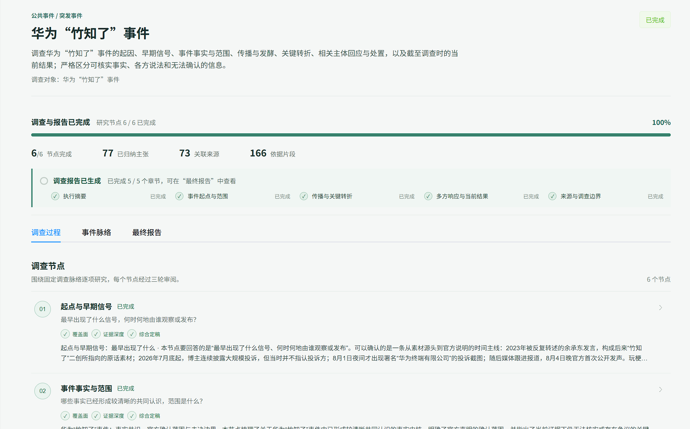
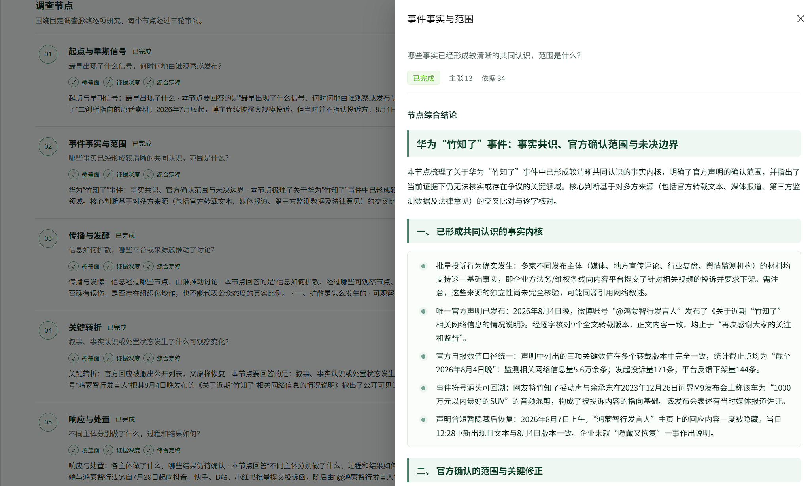
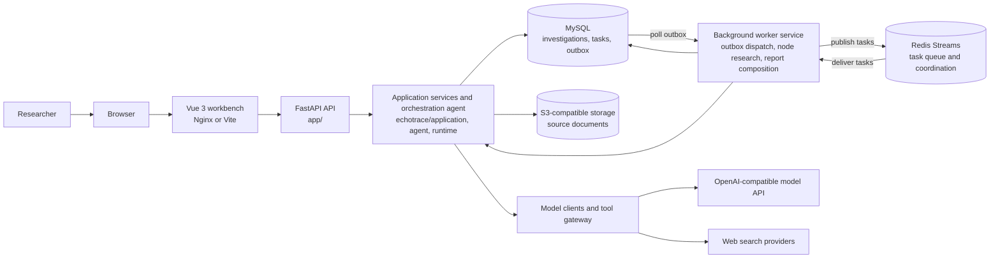
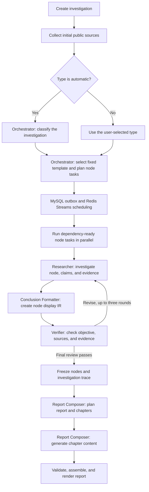

# EchoTrace

[简体中文](README.md) | English

EchoTrace is a research workbench for investigations based on public information. It connects source collection, evidence organization, node-based research, and report generation in a traceable workflow so researchers can inspect supporting material and export results.

## Screenshots

**Investigation overview** shows a completed investigation with progress across six research nodes, claim and source counts, evidence passages, and report chapter status. It gives users a single place to confirm that both research and report generation have finished.



**Node conclusion** shows the claims and evidence linked to one research node, followed by a structured synthesis organized into sections and key points. It helps reviewers distinguish established facts, the scope of official confirmation, and unresolved questions.



The Huawei "Zhuzhila" investigation shown in the screenshots is a UI example based on public material available when that run was generated. It does not represent live status or a final determination of the facts.

## Architecture

In production, the browser loads the Vue single-page app from Nginx and calls the FastAPI API. The API passes investigation commands to application services and the orchestration agent. MySQL stores business data, task state, and durable outbox events. An outbox dispatcher publishes pending work to Redis Streams, where a separate worker runs node research and report composition. The worker writes results back to MySQL and uses Redis for task delivery, leases, and model-call coordination. Model clients and tool adapters connect to external model and search services; source documents are stored in S3-compatible object storage. In local development, Vite serves the frontend and the API process starts an embedded worker.



## Multi-Agent Roles and Workflow

EchoTrace routes work to agents with distinct responsibilities; agents do not negotiate freely with each other. Each role receives a bounded task and structured context, then hands off validated data through explicit contracts. MySQL task records and Redis Streams provide durable scheduling and retries.

| Agent | Responsibility | Main output |
| --- | --- | --- |
| Orchestrator | When the user selects automatic classification, choose among registered investigation types using the objective and collected sources. Select the fixed investigation template and plan node questions, capabilities, and dependencies. | Investigation type and rationale; node task plan |
| Researcher | Research one assigned node, gather and organize sources, and produce source-backed claims, conclusions, and available datasets. Revise the node in response to verifier feedback. | Node draft, claims, evidence, datasets |
| Verifier | Check each draft against its node objective, source evidence, and round-specific review criteria. Return focused revision feedback or final approval. | Structured review |
| Conclusion Formatter | Edit an already researched node conclusion for readers without adding facts; organize it into suitable headings, paragraphs, lists, or tables. | Reader-facing node Conclusion IR |
| Report Composer | Use only the frozen investigation trace and its report template. Plan the report and chapter focus, then compose prose, lists, tables, and charts backed by available data. | Structured report and chapter content |

An investigation first collects initial sources. If its type is `auto`, the Orchestrator classifies it using the registered types and selects the corresponding template. The Orchestrator then plans tasks for the template's fixed nodes; the scheduler runs dependency-ready tasks in parallel. For each node, the Researcher produces a draft, the Conclusion Formatter prepares its display IR, and the Verifier reviews the research. The first two review rounds return focused revision requests; the third returns `finalize`, after which the Researcher completes the corresponding final revision and the node is frozen. Once every node is frozen, the Report Composer plans the report, generates its chapters, and the application validates, assembles, and renders the final document.



## Features

- Create, pause, resume, and cancel investigations while monitoring task progress.
- Organize sources, claims, and evidence across research nodes while retaining source links and investigation history.
- Generate structured reports and export JSON, Markdown, HTML, or PDF.
- Store investigation data in MySQL, coordinate background work with Redis, and keep source material in S3-compatible object storage.
- Run a local workbench built with Vue 3, TypeScript, and FastAPI.

Model-generated content requires human review. Source availability, search coverage, and model judgments affect results. Reports are not legal, medical, or investment advice.

## Stack

- Backend: Python 3.11+, FastAPI, SQLAlchemy, and Alembic
- Frontend: Vue 3, TypeScript, Vite, and Node.js 20+
- Runtime services: MySQL 8, Redis 7, and S3-compatible object storage (RustFS in Compose)
- Models: OpenAI-compatible APIs; web search can use Tavily or Bocha

## Docker Compose

Install Docker Engine and Docker Compose v2, then create a local environment file:

```powershell
Copy-Item .env.example .env
```

Edit `.env`. Set `MYSQL_ROOT_PASSWORD`, `ECHOTRACE_REDIS_PASSWORD`, `S3_ACCESS_KEY_ID`, `S3_SECRET_ACCESS_KEY`, `ECHOTRACE_LLM_BASE_URL`, `ECHOTRACE_LLM_API_KEY`, and `ECHOTRACE_LLM_MODEL`. Use unique, strong values. Use alphanumeric credentials for database, Redis, and object storage to avoid URL-encoding issues. Search API credentials are optional and depend on the selected providers.

Validate the Compose file and start the application:

```powershell
docker compose --env-file .env --profile production config --quiet
docker compose --env-file .env --profile production up --build -d
```

Open <http://localhost:8080>. The frontend is the public entrypoint. MySQL and RustFS ports bind to the local loopback interface; Redis is available only on the internal Compose network. Compose stores service data in named volumes.

## Local development

Local development requires Python 3.11+, Node.js 20+, MySQL 8, and Redis 7. RustFS can be started with Compose. After copying `.env.example`, set the local `ECHOTRACE_DATABASE_URL`, model endpoint and key, and S3 credentials. For a local Redis instance without authentication, `ECHOTRACE_REDIS_PASSWORD` can remain empty.

Install dependencies and initialize the database:

```powershell
python -m pip install -r requirements.txt
python -m alembic upgrade head
docker compose --env-file .env -f docker-compose.rustfs.yaml up -d
```

Start the backend and frontend in separate terminals:

```powershell
python main.py
```

```powershell
cd frontend
npm ci
npm run dev
```

The development workbench is available at <http://localhost:5173>; the API defaults to <http://localhost:8000>.

## Tests

```powershell
python -m pytest -q
python -m compileall -q echotrace app
cd frontend
npm ci
npm run build
```

The test suite does not require real model or search credentials. Real investigations require a configured model service and credentials for whichever search providers are enabled.

## Source tree

```text
EchoTrace/
├── app/                         # FastAPI entrypoint, routes, dependency composition
│   ├── main.py
│   ├── investigation_composition.py
│   └── routers/
├── echotrace/
│   ├── agent/                   # Orchestration agent, model clients, prompts, context
│   ├── application/             # Investigation use cases, node research, report pipeline
│   ├── domain/                  # Investigation, node-task, and report models
│   ├── runtime/                 # Node orchestration, execution policies, tool gateway
│   ├── infrastructure/
│   │   ├── coordination/redis/  # Outbox dispatch, Streams, workers, coordination
│   │   └── persistence/mysql/   # Database, models, repositories
│   ├── ingestion/               # RSS ingestion and document normalization
│   ├── tool_providers/          # Search, page fetching, and ingestion tools
│   ├── skills/                  # Agent skills and evaluation cases
│   ├── report_templates/        # Report templates by investigation type
│   └── worker.py                # Background worker process entrypoint
├── frontend/src/
│   ├── api/                     # Backend API client
│   ├── components/trace/        # Node conclusions and evidence views
│   ├── router/
│   └── views/                   # Investigation workbench
├── migrations/versions/         # Alembic database migrations
├── tests/                       # Backend, agent, and tool-provider tests
├── assets/screenshots/          # README screenshots
├── .env.example                 # Local environment template
├── Dockerfile.backend
├── Dockerfile.frontend
├── docker-compose.yaml          # Production service composition
├── main.py                      # Local development entrypoint
└── requirements.txt             # Python dependencies
```

## Contributing and security

Read the [contribution guide](CONTRIBUTING.md) before opening a pull request. Report security issues privately as described in the [security policy](SECURITY.md). Do not post credentials or sensitive investigation material in public issues.

## License

This project is licensed under the [MIT License](LICENSE).
