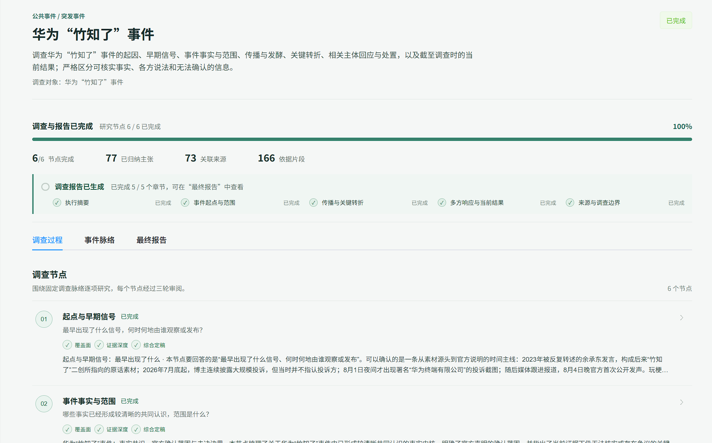
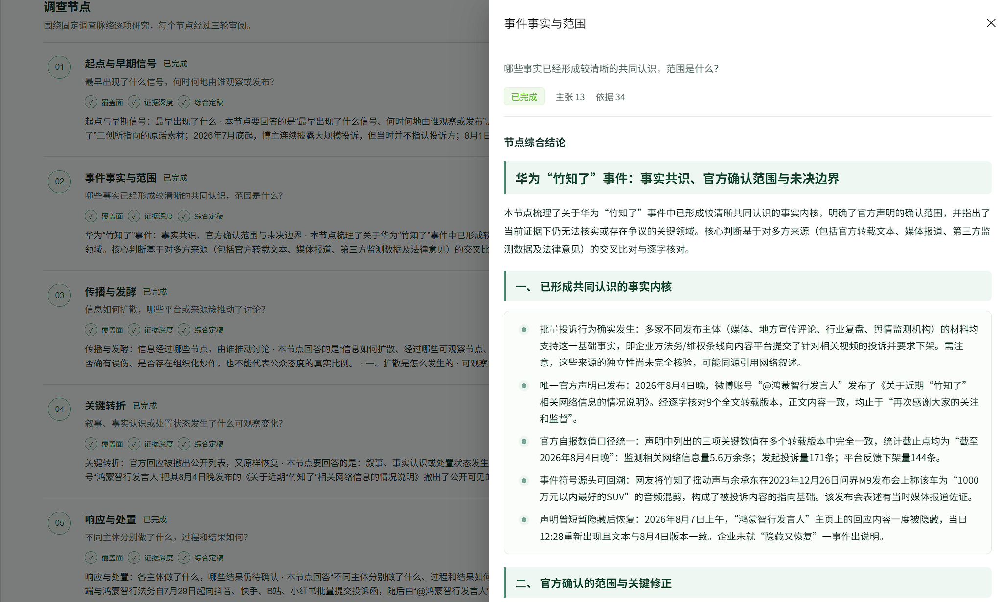
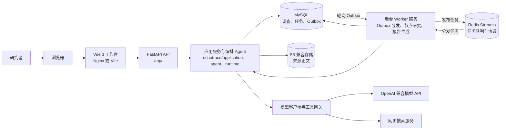
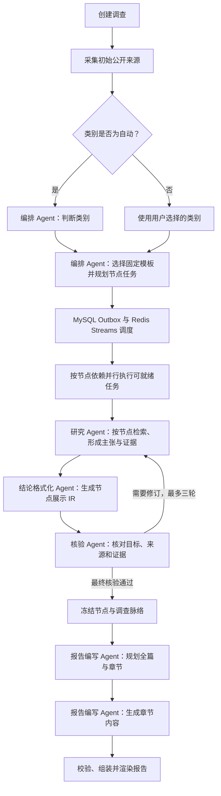

# EchoTrace

简体中文 | [English](README.en.md)

EchoTrace 是一个面向公开信息调查的研究工作台。它把资料采集、证据整理、调查节点研究和报告生成串成可追踪的流程，方便研究者查看结论依据、检查来源并导出报告。

## 界面展示

**调查总览**展示一次已完成的调查，包括 6 个研究节点的进度、归纳主张数、关联来源数、依据片段数，以及报告章节生成状态。用户可以从同一页面查看调查是否真正完成。



**节点综合结论**展示单个研究节点的主张与依据概览，并将综合结论按语义组织为分节内容和要点，便于核对已确认事实、官方确认范围与尚未解决的问题。



截图中的华为“竹知了”调查是界面效果示例，内容反映该次调查生成时可获得的公开材料，不代表实时状态或最终事实认定。

## 系统架构

生产环境中，浏览器通过 Nginx 提供的 Vue 单页应用访问 FastAPI。API 将调查命令交给应用服务和编排 Agent：业务数据、任务状态及 Outbox 事件持久化在 MySQL；Outbox Dispatcher 将待执行任务发布到 Redis Streams，由独立 Worker 执行节点研究与报告生成。Worker 将结果写回 MySQL，并通过 Redis 协调任务分发、租约和模型调用限流。模型客户端和搜索工具适配器分别连接外部模型及搜索服务，来源正文存入 S3 兼容对象存储。开发模式下 Vite 提供前端，API 进程会内置启动 Worker。



## 多 Agent 分工与调查流程

EchoTrace 由编排 Agent 按需调用不同职责的 Agent，不是让所有 Agent 自由协商。每个角色接收范围明确的任务和结构化上下文，通过校验后的数据合同交接结果；MySQL 中的任务记录和 Redis Streams 负责持久化调度及重试。

| Agent | 职责 | 主要产物 |
| --- | --- | --- |
| 编排 Agent（Orchestrator） | 用户选择自动分类时，根据目标和已采集来源在已注册的调查类别中分类；选择固定调查模板，并为模板节点规划问题、能力和依赖。 | 类别与理由、节点任务计划 |
| 研究 Agent（Researcher） | 按分配的节点问题检索和整理来源，形成有来源证据支撑的主张、结论及可用数据集；根据核验反馈进行定向修订。 | 节点研究稿、主张与证据、数据集 |
| 核验 Agent（Verifier） | 对照节点目标、来源证据和本轮审查重点，检查研究稿并指出缺口；返回修订意见或最终通过状态。 | 结构化核验意见 |
| 结论格式化 Agent（Conclusion Formatter） | 不增加事实，对已核验的节点结论做面向读者的语义编辑，整理标题、段落、列表或表格。 | 节点展示用 Conclusion IR |
| 报告编写 Agent（Report Composer） | 只使用冻结后的调查脉络和对应报告模板，先规划全篇与章节重点，再按章节组织文字、列表、表格和有数据依据的图表。 | 结构化报告及章节内容 |

一次调查先采集初始来源；如类别为“自动”，由编排 Agent 从系统已有类别中判断并选择对应模板。随后编排 Agent 按模板规划固定节点，调度器依据节点依赖并行执行可独立开展的任务。研究 Agent 完成一个节点后，结论格式化 Agent 生成展示 IR，Verifier 对研究内容进行审查；前两轮审查返回定向修订意见，第三轮返回 `finalize`，研究 Agent 随后完成对应的最终修订版本并冻结节点。全部节点冻结后，Report Composer 规划报告并生成各章节，最后由应用按报告合同校验、组装并渲染。



## 功能

- 创建、暂停、恢复和取消调查，并查看任务进度。
- 使用多个研究节点整理来源、主张和证据，保留来源链接及调查过程。
- 生成结构化调查报告，支持 JSON、Markdown、HTML 和 PDF 导出。
- 使用 MySQL 保存调查数据、Redis 协调后台任务，并用 S3 兼容存储保存来源材料。
- 提供基于 Vue 3、TypeScript 和 FastAPI 的本地工作台。

模型生成内容需要人工核查。来源可访问性、搜索覆盖率和模型判断会影响结果；报告不应被当作专业法律、医疗或投资意见。

## 技术栈

- 后端：Python 3.11+、FastAPI、SQLAlchemy、Alembic
- 前端：Vue 3、TypeScript、Vite、Node.js 20+
- 运行依赖：MySQL 8、Redis 7、S3 兼容对象存储（Compose 默认使用 RustFS）
- 模型：OpenAI 兼容接口；网页搜索可配置 Tavily 或博查

## 使用 Docker Compose

需要 Docker Engine 和 Docker Compose v2。先创建本地配置文件：

```powershell
Copy-Item .env.example .env
```

编辑 `.env`，至少配置 `MYSQL_ROOT_PASSWORD`、`ECHOTRACE_REDIS_PASSWORD`、`S3_ACCESS_KEY_ID`、`S3_SECRET_ACCESS_KEY`，以及 `ECHOTRACE_LLM_BASE_URL`、`ECHOTRACE_LLM_API_KEY` 和 `ECHOTRACE_LLM_MODEL`。请使用专用的强随机值；数据库、Redis 和对象存储凭据请使用字母数字字符，避免连接 URL 编码问题。搜索 API 凭据按需配置。

检查 Compose 配置并启动：

```powershell
docker compose --env-file .env --profile production config --quiet
docker compose --env-file .env --profile production up --build -d
```

打开 <http://localhost:8080>。前端入口对外提供服务；MySQL 和 RustFS 端口仅绑定到本机回环地址，Redis 只在 Compose 内部网络开放。Compose 使用独立的数据卷保存服务数据。

## 本地开发

本地开发需要 Python 3.11+、Node.js 20+、MySQL 8 和 Redis 7。RustFS 可通过 Compose 启动。复制 `.env.example` 后，设置本机数据库连接 `ECHOTRACE_DATABASE_URL`、模型接口参数和 S3 凭据；Redis 无认证时可将本地 `ECHOTRACE_REDIS_PASSWORD` 留空。

安装依赖并初始化数据库：

```powershell
python -m pip install -r requirements.txt
python -m alembic upgrade head
docker compose --env-file .env -f docker-compose.rustfs.yaml up -d
```

分别在两个终端启动后端和前端：

```powershell
python main.py
```

```powershell
cd frontend
npm ci
npm run dev
```

开发工作台默认运行在 <http://localhost:5173>，后端 API 默认运行在 <http://localhost:8000>。

## 测试

```powershell
python -m pytest -q
python -m compileall -q echotrace app
cd frontend
npm ci
npm run build
```

测试套件不需要真实模型或搜索服务凭据。真实调查需要在本地 `.env` 配置模型服务，并按所用搜索工具配置相应凭据。

## 项目代码结构

```text
EchoTrace/
├── app/                         # FastAPI 入口、路由与依赖组装
│   ├── main.py
│   ├── investigation_composition.py
│   └── routers/
├── echotrace/
│   ├── agent/                   # 编排 Agent、模型客户端、提示词与上下文
│   ├── application/             # 调查用例、节点研究、报告合成与渲染
│   ├── domain/                  # 调查、节点任务和报告领域模型
│   ├── runtime/                 # 节点编排、执行策略与工具网关
│   ├── infrastructure/
│   │   ├── coordination/redis/  # Outbox 分发、Streams、Worker 与协调器
│   │   └── persistence/mysql/   # 数据库、模型与仓储
│   ├── ingestion/               # RSS 与资料规范化
│   ├── tool_providers/          # 搜索、网页抓取和导入工具
│   ├── skills/                  # Agent 工作技能与评估用例
│   ├── report_templates/        # 按调查类型配置的报告模板
│   └── worker.py                # 后台 Worker 进程入口
├── frontend/src/
│   ├── api/                     # 后端 API 客户端
│   ├── components/trace/        # 节点结论与证据展示
│   ├── router/
│   └── views/                   # 调查工作台
├── migrations/versions/         # Alembic 数据库迁移
├── tests/                       # 后端、Agent 与工具提供器测试
├── assets/screenshots/          # README 界面截图
├── .env.example                 # 本地环境配置模板
├── Dockerfile.backend
├── Dockerfile.frontend
├── docker-compose.yaml          # 生产服务编排
├── main.py                      # 本地开发启动入口
└── requirements.txt             # Python 依赖
```

## 贡献与安全

请先阅读[贡献指南](CONTRIBUTING.md)。发现安全问题时，请按[安全政策](SECURITY.md)中的方式私下报告，不要在公开 Issue 中粘贴凭据或敏感调查材料。

## 许可证

本项目采用 [MIT License](LICENSE)。
